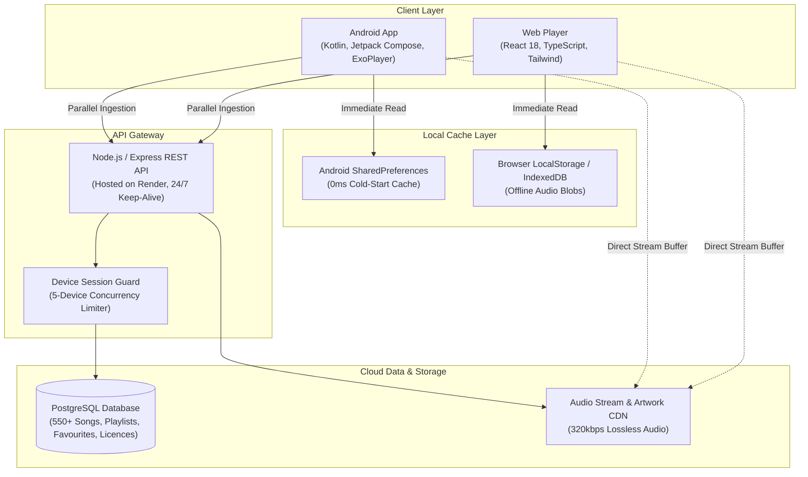

# 🎵 Melody — Production-Grade Music Streaming Ecosystem

[](https://melody-chi-nine.vercel.app)
[](https://melody-chi-nine.vercel.app/Melody-v1.0.8.apk)
[](https://github.com/SonyLucky7/melody/releases/tag/v1.0.8)
[](https://kotlinlang.org)
[](https://developer.android.com/jetpack/compose)
[](https://react.dev)

> **Melody** is a modern, high-fidelity music streaming ecosystem engineered for seamless audio playback across mobile and web. It features a native **Android application** (Jetpack Compose, ExoPlayer, Foreground Service), a responsive **Web player** (React 18, TypeScript, Tailwind CSS), a scalable **REST API** (Node.js, Express, PostgreSQL), and an automated **CI/CD pipeline** with GitHub Actions.

---

## 🌐 Live Demos & Releases

| Platform | Link | Description |
| :--- | :--- | :--- |
| 🌍 **Web Player** | [melody-chi-nine.vercel.app](https://melody-chi-nine.vercel.app) | Responsive Spotify-grade Web Application (Mobile + Desktop). |
| 📱 **Android App (APK)** | [Download Melody v1.0.8 APK](https://melody-chi-nine.vercel.app/Melody-v1.0.8.apk) | Direct production APK with offline storage, background audio, and lock-screen widget. |
| 🏷️ **GitHub Releases** | [Releases & Changelog](https://github.com/SonyLucky7/melody/releases) | Versioned release tags, compilation artifacts, and changelog history. |

---

## 📱 User Experience & Key Features

### 1. Spotify-Grade Multiplatform UI/UX
- **Curated Playlists & Mixes Carousel**: Horizontal scrolling cards featuring high-res artwork, track counts, and artist preview descriptions (*Motivation Vol. 1 & 2, TikTok Phonk, Slowed + Reverb Essentials, Sidhu Moose Wala Legends, Yo Yo Honey Singh Blockbusters, The Weeknd Master Collection, Lana Del Rey Aesthetics, Ariana Grande Top Hits*).
- **Popular Artists & Discographies**: Circular artist profiles with monthly listener statistics, verified artist biographies, and complete song discographies.
- **2x3 Quick Picks Grid**: Context-aware dynamic greetings (*Good morning, Good afternoon, Good evening*) and 6 top quick-play cards with instantaneous playback.
- **Floating Mini Player & Full-Screen Sheet**: Fluid bottom mini-player bar expanding to a full-screen playback sheet with audio scrubber, queue management, and favourite toggles.

### 2. High-Performance Background Audio (Android)
- **AndroidX Media3 / ExoPlayer Service**: Foreground audio service running independently of the UI lifecycle to prevent OS termination during multitasking.
- **Lock Screen & Media Notification**: Native media controls with seek bar, play/pause, next/previous buttons, and high-res album art synchronization.
- **Android Home Screen Widget**: Custom AppWidget allowing one-tap play/pause and track skipping directly from the user's home screen.

### 3. Zero-Data Scoped Offline Storage
- **Android Scoped Storage**: Downloads lossless 320kbps MP3s into app-private scoped directory (`context.filesDir/downloads`), preventing pollution of the user's public gallery while enabling zero-data offline playback.
- **Web IndexedDB Storage**: Client-side audio blob and cover art caching in browser IndexedDB with real-time download progress and disk usage monitoring.

### 4. Multi-Device Session Guard
- **Device Fingerprinting**: Assigns unique device tokens (`android-<uuid>`, browser instance) with a strict **5-device limit** per VIP account.
- **Remote Session Management**: Inspect all active logged-in sessions (device name, last active timestamp) and remotely revoke access to free up slots.

---

## 🏗️ System Architecture



---

## ⚡ Engineering Challenges & Solutions

### 🚀 1. Bypassing Backend Catalog Truncation with Parallel Pagination
- **The Challenge**: The production REST API capped responses to 100 songs per request. A single call requesting all songs truncated the catalog, causing 450+ songs (including popular Punjabi and International artists) to be missing from the apps.
- **The Solution**: 
  - Engineered an asynchronous parallel pagination engine.
  - **Android (Kotlin)**: Leveraged Kotlin Coroutines `async(Dispatchers.IO)` with `awaitAll()` across offsets `[0, 100, 200, 300, 400, 500, 600]`, fetching all 552 songs concurrently in ~1.1 seconds.
  - **Web (TypeScript)**: Implemented non-blocking `Promise.all` chunked requests with `Set`-based deduplication.
  - Coupled with local persistent disk caching (`SharedPreferences` / `localStorage`) for **0ms cold-start app rendering**.

### 🎵 2. Android 14 Foreground Audio Service & Audio Focus
- **The Challenge**: Android 13 and 14 aggressively kill background tasks and mandate explicit runtime media permissions (`POST_NOTIFICATIONS`), causing audio to cut off when locking the phone or switching apps.
- **The Solution**: 
  - Designed `MelodyPlaybackService` extending AndroidX Media3 / ExoPlayer as a declared Foreground Service with `foregroundServiceType="mediaPlayback"`.
  - Implemented AudioManager audio focus management, allowing seamless audio ducking during phone calls or GPS navigation, resuming automatically upon completion.

### 🛡️ 3. Instant 0ms Playlist Fallback Resolution
- **The Challenge**: On slower mobile networks, users opening curated playlists before the background network catalog sync finished experienced empty screens ("0 tracks").
- **The Solution**:
  - Implemented reactive fallback observers in Jetpack Compose (`LaunchedEffect(allSongs)`) and React (`useEffect`).
  - Derived immediate tracks from local memory while displaying a smooth loading skeleton rather than an empty state, auto-updating seamlessly as soon as the background sync settles.

### 🤖 4. Automated Multiplatform CI/CD Pipeline
- **The Challenge**: Manual Android compilation and asset hosting produced version mismatches between the website download link and the repository code.
- **The Solution**:
  - Configured a GitHub Actions workflow on `ubuntu-latest` with JDK 17 and Gradle 8.4.
  - On push to `main`, the workflow compiles `gradle assembleDebug`, uploads build artifacts, triggers a GitHub Release with version tagging (`v1.0.7`), and deploys the compiled 22.6MB APK directly to the public web assets on Vercel CDN.

---

## 🛠️ Technology Stack Breakdown

| Layer | Technologies | Purpose |
| :--- | :--- | :--- |
| **Android Native** | Kotlin, Jetpack Compose, Material 3, AndroidX Media3 (ExoPlayer), Coil, Retrofit2, Coroutines, Flow, AppWidget | Native Android UI, persistent background audio playback, lock screen media controls, home screen widget, scoped storage offline saving. |
| **Frontend Web** | React 18, TypeScript, Vite, Tailwind CSS, Lucide Icons, HTML5 Web Audio API, IndexedDB | Responsive desktop/mobile web player, client-side offline audio blob caching, custom audio waveform scrubbing. |
| **Backend & APIs** | Node.js, Express.js, RESTful Routing, JWT, CORS | High-throughput song catalog API, stream URL resolver, license activation engine, device concurrency manager. |
| **Database** | Managed PostgreSQL (Aiven Cloud), `pg` connection pool | Relational schema modeling songs, curated & custom playlists, liked tracks, user profiles, and active device sessions. |
| **DevOps & CI/CD** | GitHub Actions, Git, Ubuntu Runner, Gradle Daemon, Vercel, Render | Automated Android compilation, automated GitHub Releases, zero-downtime web deployment. |

---

## 📂 Project Repository Structure

```
melody/
├── .github/workflows/          # CI/CD Workflows (Android APK build & release)
│   └── build-android.yml
├── android/                    # Native Android Mobile Application
│   ├── app/src/main/java/com/melody/music/
│   │   ├── ads/                # Ad and activation management
│   │   ├── data/api/           # Retrofit2 API services & client
│   │   ├── data/model/         # Data classes (Song, Playlist, Profile)
│   │   ├── player/             # ExoPlayer & Media3 Foreground Service
│   │   ├── ui/components/      # MiniPlayer, FullPlayer, Activation dialogs
│   │   ├── ui/screens/         # HomeScreen, LibraryScreen, ArtistScreen
│   │   └── widget/             # Android Home Launcher AppWidget
│   └── build.gradle
├── client/                     # React 18 + TypeScript Web Application
│   ├── public/                 # Static assets & compiled Android APK binaries
│   │   ├── Melody-v1.0.8.apk   # Authentic production Android binary
│   │   └── covers/             # Album artwork & artist profile images
│   ├── src/
│   │   ├── components/         # Sidebar, PlayerBar, SongRow, Modals
│   │   ├── services/           # API services & parallel pagination
│   │   ├── context/            # Audio Player React Context
│   │   └── App.tsx             # Main Web Player application
│   └── package.json
├── server/                     # Node.js + Express API Backend
│   ├── src/
│   │   ├── routes/             # REST API endpoints (songs, playlists, auth)
│   │   ├── db/                 # PostgreSQL migrations & connection pooling
│   │   └── index.ts            # Express server entry point
│   └── package.json
└── README.md
```

---

## 💻 Local Development Setup

### Prerequisites
- **Node.js**: v18+ and `npm`
- **JDK**: Java Development Kit 17+
- **Android SDK**: Android Studio with API Level 34 SDK (for mobile builds)

### 1. Web Application (`client/`)
```bash
cd client
npm install
npm run dev
# Web player will run on http://localhost:5173
```

To create a production build:
```bash
npm run build
```

### 2. Android Native Application (`android/`)
Open the `android/` directory in **Android Studio**:
- Let Gradle sync dependencies.
- Select an Android Virtual Device (AVD) or connect a physical device via USB debugging.
- Click **Run** (`Shift + F10`) or compile the debug APK via CLI:
```bash
cd android
./gradlew assembleDebug
```
The output APK will be generated at:
`android/app/build/outputs/apk/debug/app-debug.apk`

### 3. API Backend (`server/`)
```bash
cd server
npm install
npm run dev
# Server will run on http://localhost:5000
```

---

## 📄 License & Attribution

This project is built for educational, portfolio, and non-commercial streaming purposes. All artist tracks and audio streams are property of their respective copyright holders.
